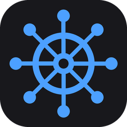

<div align="center">



# Helm

**A Windows 11 taskbar replacement, in Rust.**

One dark, fast bar per monitor with your windows, tray, quick settings, launcher, calendar and web mail/chat, all in a single small process.


</div>

---

Helm hides the native taskbars and draws its own on every monitor. It is built with [Slint](https://slint.dev) (winit, software renderer) for the UI and Win32 for windows, tray, audio, network and input. Native taskbars are restored on quit, and a watchdog process restores them if Helm ever crashes.

> **Requires Windows 11** and the [WebView2 runtime](https://developer.microsoft.com/microsoft-edge/webview2/) (preinstalled on Windows 11) for the web services.

## Features

**Taskbar**
- A bar per monitor, with per-monitor pinned apps, icon-only buttons, drag-to-reorder and remembered order
- Taskbar progress, overlay badges and attention flashing
- Icon overrides by exe and window title
- Clock with optional seconds and date; tray, language and clock can sit on either side

**System**
- Own system tray with an overflow flyout and tooltips
- Quick settings: volume and per-app mixer, output device, Wi-Fi / Ethernet, Bluetooth with battery, keyboard language, and a calendar
- Start launcher with app search, pinned grid and power buttons; replaces the Win key behaviour

**Web services (replaces a Ferdium-style app)**
- Gmail (several accounts), Messenger, Outlook and Teams, each in its own persistent WebView2 profile
- Grouped bar buttons (Personal / Work) with unread badges and flashing for new mail
- Unread mail lists with hover previews, mark as read, and a side panel that opens a single mail
- An optional schedule, so a group such as Work is closed completely outside its hours
- Per-site adapters are plain JavaScript in `webservices/src/adapters/` and can be overridden from `%APPDATA%\Helm\services\<id>.js`

**Customisation**
- Settings window with themes and presets, accent-derived palettes, animation and popup speed
- Setting profiles you can save, load, export and import
- Everything lives in a single hand-editable `config.toml` that reloads live

## Build and run

You need a recent stable Rust toolchain with the MSVC target.

```
cargo build --release --workspace
target\release\helm.exe
```

If the build fails with "failed to remove winkey_hook.dll", `StartMenuExperienceHost.exe` still has the hook loaded. Stop that process (Windows restarts it) and build again.

To work on the web services without the taskbar:

```
cargo run -p webservices --bin dev -- [--debug] [--show gmail1,teams|all] [--only teams,outlook]
```

## Project layout

| Path | Purpose |
|------|---------|
| `src/main.rs` | startup, 500 ms tick, refresh |
| `src/shell.rs`, `tasks/` | bars per monitor, window list, button layout |
| `src/tray/` | own `Shell_TrayWnd`, tray icon model, overflow flyout |
| `src/popup/`, `menu.rs`, `calendar.rs`, `start/` | popup windows, context menus, calendar, Start launcher |
| `src/quick/` | quick settings: audio and mixer, Wi-Fi, Bluetooth, language |
| `src/settings/` | Settings window wiring (themes, bar, tray, monitors, profiles, services) |
| `src/services.rs`, `webservices/` | built-in web services in WebView2: bar groups, badges, flashing, mail lists and panel, schedule |
| `src/config/` | `config.toml`, live reload, profiles |
| `src/theme.rs` | pushes theme values to every Slint window |
| `ui/*.slint` | Slint sources, split into widgets, previews and windows |
| `winkey_hook/` | DLL injected into the Start menu hosts to block the native Start menu |

## Data

Everything lives under `%APPDATA%\Helm\` (an existing `rust_taskbar` folder is moved there on first run):

- `config.toml`: all settings; hand edits are picked up live
- `profiles\*.toml`: saved setting profiles (Settings > Profiles)
- `web\`: browser profiles for the web services
- `services\`: optional adapter overrides
- `log.txt`: errors such as failed saves or an invalid `config.toml` (restarts after 256 KB)

## Conventions

- Single UI thread; global state is in `thread_local!` cells. Do not hold a `borrow_mut()` across calls that can re-enter.
- Config edits go through `update_ui` / `update_theme` / `update_monitor` / `update_svc`; do not clone, edit and save by hand.
- Slint popup windows share `Theme.popup-surface` as their background so they repaint reliably.

## Notes and disclaimers

- **Not affiliated.** Helm is an independent project. It is not affiliated with, endorsed by or sponsored by Microsoft, Google or Meta. Windows, Outlook, Teams, Gmail, Google and Messenger are trademarks of their respective owners and are used here only to describe compatibility.
- **Web services.** Gmail, Outlook, Teams and Messenger are shown by loading their normal web pages in an embedded WebView2 and reading unread counts from the page. This is not an official API. It is intended for your own accounts, may break when the sites change, and may be restricted by those services' terms. Use at your own risk.
- **Start menu hook.** To intercept the Win key, Helm loads a small hook DLL into the Windows Start menu host process. Some antivirus tools may flag this behaviour. Review the source in `src\start` before running a build.
- **No warranty.** Helm replaces a core part of the shell. It is provided as is, without warranty; see the license.

## License

Helm is licensed under the [GNU General Public License v3.0](LICENSE). It uses Slint under the GPLv3 option of its [licensing terms](https://slint.dev/terms-and-conditions); other dependencies are MIT or Apache-2.0.

## Acknowledgements

Built with [Slint](https://slint.dev), the [`windows`](https://github.com/microsoft/windows-rs) crate and [`webview2-com`](https://github.com/wravery/webview2-com).
